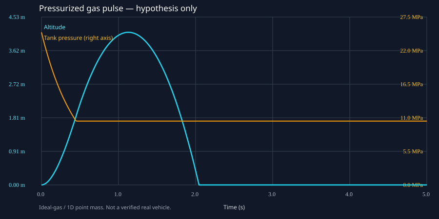

# SimWhy

**Understand how it *could* work, with simulations you can run and inspect.**

[中文说明](README.zh-CN.md) · [Research catalog](catalog/README.md) · [Model limitations](docs/assumptions.md)

SimWhy is a small open-source starting point for people without a wind tunnel, laboratory hardware, or expensive solver licenses. Reproduce an engineering *hypothesis* with simple physics, vary assumptions, inspect numerical evidence, and say explicitly what the model **cannot** establish.

**First experiment:** Could a pressurized gas pulse lift a vehicle-like mass off the ground? This is *not* a reconstruction of the Tesla Roadster's actual hardware or control design. The October 2026 demonstration motivates the question; all example tank/nozzle dimensions are hypothetical.

## Run in under a minute

**Requires only Python 3.10+ (standard library). No API keys, paid solver, GPU, or dependencies.**

```bash
git clone https://github.com/yuhangheng/simwhy.git
cd simwhy
python -m unittest discover -s tests -v
python -m simwhy run examples/pressurized_jump.json --out results/pulse
python -m simwhy run examples/insufficient_thrust.json --out results/no-lift
```

Windows: replace `python` with the full path to an installed Python interpreter if Windows app execution aliases intercept it.

Each run creates:
- `trajectory.svg` — open directly in a browser, no plotting package.
- `trajectory.csv` — time-resolved altitude, velocity, tank pressure, temperature, gas mass, mass flow, thrust.
- `summary.json` — peak height, initial thrust/weight, gas used, mass accounting, and **half-step numerical sensitivity**.

Example output with the *illustrative* `pressurized_jump.json` (Python standard-library model):

```text
Peak altitude: 4.1173 m
Initial thrust/weight: 3.79
Gas used: 32.53 kg
Time-step peak difference: 0.176%
Model credibility: SIMULATION_ONLY_NOT_HARDWARE_VALIDATED
```



The contrasting low-pressure case cannot lift its assumed mass and produces **0 m** peak altitude. The pressure/throat/tank choices are examples, **not estimates of a real vehicle**. Even a small step-size difference is **not** experimental validation.

## What is actually simulated

A fixed-volume, uniformly mixed **ideal-gas** tank (adiabatic blowdown), compressible flow through a simplified convergent nozzle (choked and unchoked), and an upward-pointing force acting on a one-dimensional point mass. With valve open, the solver evolves mass, temperature, pressure, thrust, vertical velocity and altitude; after cutoff, it predicts ballistic motion.

**Not modeled:** nonideal high-pressure nitrogen, real tank/valve hardware, heat transfer, multi-nozzle plumbing, structural/landing loads, vehicle pitch/roll/yaw, a suction fan, traction, nozzle geometry losses, ground-effect and regulatory constraints. At tens of MPa, nonideal-gas error may be important. **Do not use this code to design or operate pressure vessels or vehicles.** See [full scope](docs/assumptions.md).

## Why not just a CFD agent?

Real engineering mistakes include corrupted checkpoint writes, residual convergence falsely equated with physical stationarity, unit errors, wrong experiment coordinates, and invented provenance. A model producing an attractive animation does not imply a trustworthy explanation. SimWhy aims to couple **short runnable experiments, explicit uncertainty, reproducible evidence, and later AI tool orchestration**—without claiming that an AI's opinion validates a simulation.

Current version is **a dependency-free model and test harness**, *not yet* an autonomous research agent, full physical verification suite, flight simulator, engine digital twin, or universal inverse-design system.

## Research and reproduction ecosystem

Curated, inspected project links live in [catalog/README.md](catalog/README.md). They include **ReproAgent** (paper-to-code contracts), **ReproRepo** (paper/repository reproducibility audit), **PaperQA2**, **AeroSandbox**, **SU2**, **OpenMDAO**, **DAFoam**, **RocketPy**, **JSBSim**, **PyFR**, **OpenSBLI**, **PhysicsNeMo**, and **AI Scientist**. Each entry records what to borrow and what was *not* verified.

The research goal is broader than aerospace: *easy, affordable, inspectable simulations of real mechanisms*, with adapter-based expansion to **MATLAB/Simulink**, **Fluent**, open CFD codes and independently reproduced papers.

## Contribute a phenomenon

Open a GitHub Issue with: a publicly documented phenomenon, source evidence, physical quantities/units, the *minimum* model capable of falsifying a claim, independent sanity checks, and what real data would be needed for validation. **Do not upload third-party proprietary models, confidential CAD, personal data, or unlicensed papers.**

## Status and citation

- v0.1: 1D gas-pulse hypothesis + 10 automated tests + editable examples + chart/data exports.
- Future: explicit uncertainty bounds, real-gas correction, pitch-control toy model, more physics cases, solver adapters, paper-reproduction contracts.
- License: MIT. Maintainer: Heng Yuhang.
- Evidence standard: reproducible runs first; no fictional experimental data or fabricated confidence intervals.
